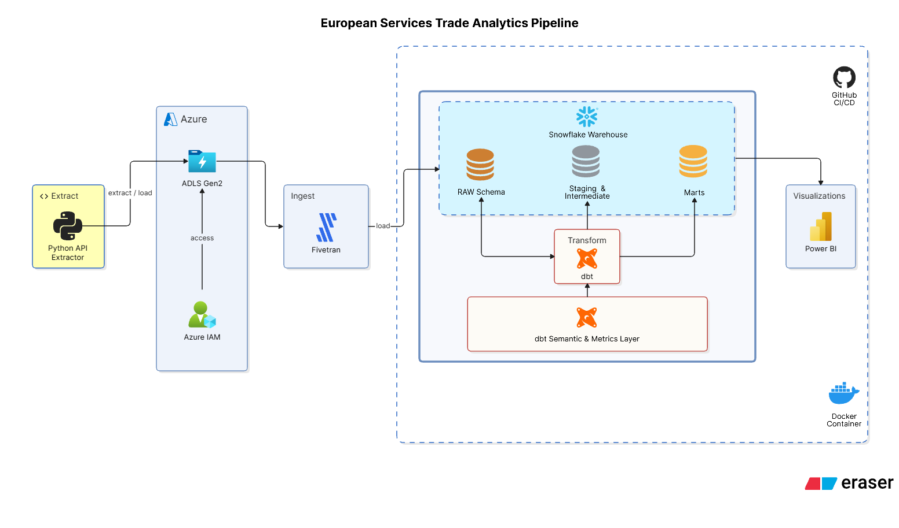
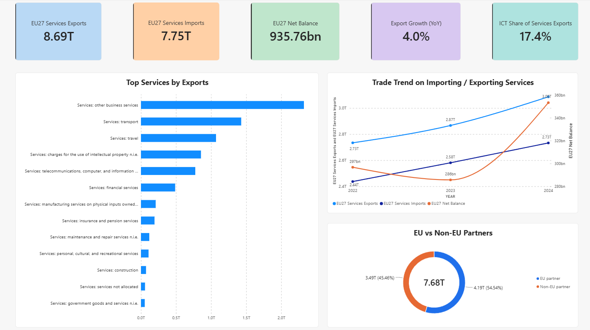
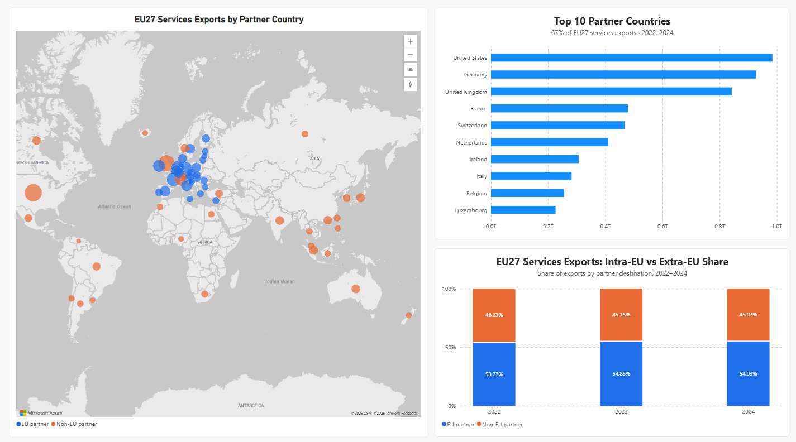
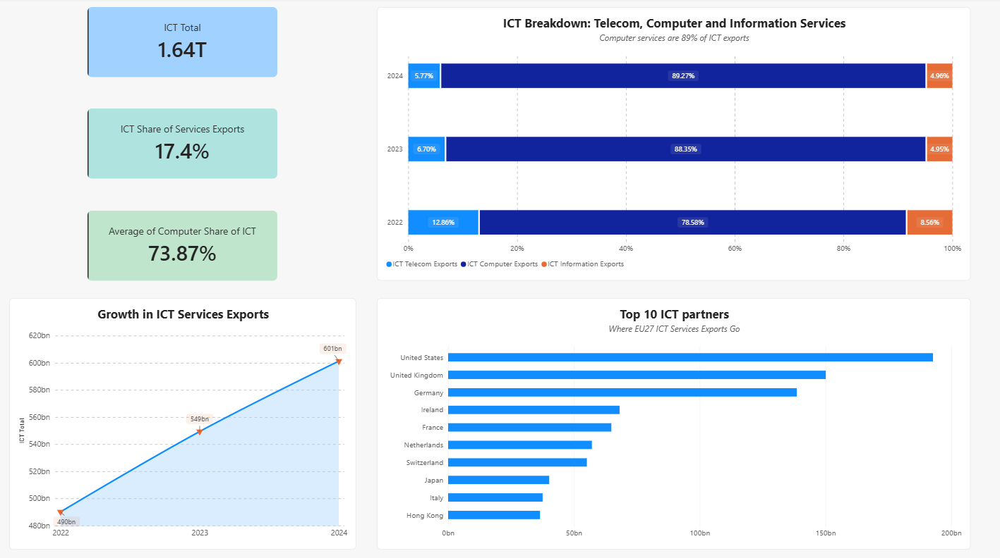
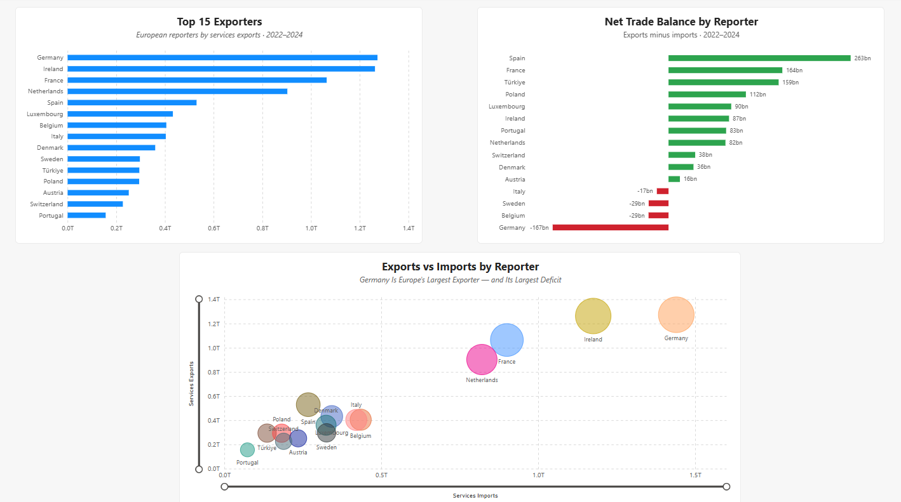
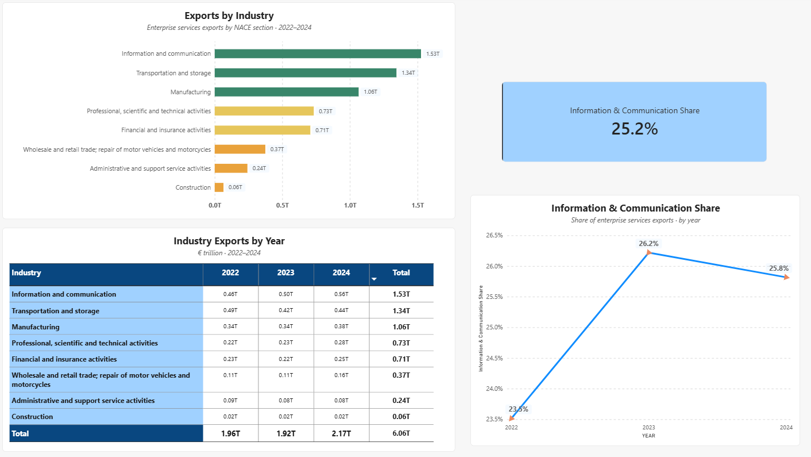
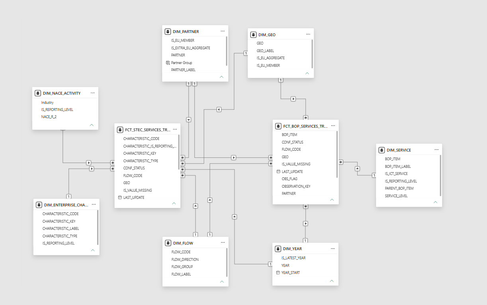

# European Services Trade Analytics

How European countries trade services with the rest of the world, 2022–2024.

Eurostat publishes the raw numbers. This project turns them into a governed dataset and a Power BI report that answers questions like _how big is Europe's ICT trade, where does it go, and which countries run a surplus?_

## What the data shows

- EU27 services exports reached **€3.09 trillion in 2024**, from €8.69tn over the three years.
- Imports over the same period were €7.75tn — a **€936bn surplus**.
- **ICT services are 17.4%** of exports. Within ICT, computer services are the largest part — 74% across all reporting countries, 89% at EU27 level.
- **45.1% of EU27 exports go outside the EU.** That share is drifting down slowly.
- **Information & communication** is the largest industry, at 25.2% of enterprise services exports.
- Germany is Europe's largest services exporter — and its largest deficit country, at −€167bn.

## Pipeline Architecture



Eurostat is extracted by a Python client, landed in Azure Data Lake Storage, loaded to Snowflake by Fivetran, transformed by dbt, and reported in Power BI. See [System design](docs/system-design.md) for architecture, environments and pipeline details.

## Power BI Dashboards

Five pages, built on a shared semantic model.

### Executive Overview



### Trade Geography



### ICT Deep Dive



### Performance & Rankings



### Enterprise Industry



Report and model: [`powerbi/european-services-analytics.pbip`](powerbi/european-services-analytics.pbip) (PBIP format, stored as plain text).

## Data model



Two fact tables — one for balance-of-payments trade, one for the enterprise survey — share four dimensions (year, flow, partner, reporting country) and each adds its own. The shared dimensions are what make the two datasets comparable; the separate ones are why they can't be added together.

## Handling the data

Eurostat figures look simpler than they are. Three things needed deliberate handling:

- **Overlapping totals.** Each hierarchy publishes totals alongside their parts. The commercial-services code sits beside the 13 service sections; the EU27 row sits beside its 27 members; the enterprise survey publishes three alternative views of the same euros. Summing without picking one level at a time inflates exports several times over.
- **Suppressed values.** About 18% of raw observations are missing or confidential; on the reporting grain the figure is closer to 5%. Data exists but isn't publishable, so these stay null rather than becoming zero — totals understate where suppression is heavy rather than quietly inventing accuracy.
- **Estimated figures.** Part of the enterprise survey is Eurostat estimate rather than reported data. Worth knowing before treating any single number as exact.

Each measure pins one reporting level, one reporter and one partner — see [`docs/system-design.md`](docs/system-design.md).

## Data sources

Four Eurostat datasets:

- `bop_its6_det` — trade in services by detailed service category.
- `ext_stec01` — trade by enterprise size.
- `ext_stec02` — trade by service category and economic activity.
- `ext_stec03` — trade by economic activity and ownership.

Coverage and extraction settings: [`config/datasets.yaml`](config/datasets.yaml).

## Repository guide

| Path                    | Purpose                                                       |
| ----------------------- | ------------------------------------------------------------- |
| `src/extract/eurostat/` | Eurostat extraction, validation, manifests, and ADLS upload   |
| `config/datasets.yaml`  | Dataset definitions and extraction coverage                   |
| `dbt/`                  | Staging, intermediate, and mart models, seeds, and tests      |
| `powerbi/`              | Version-controlled Power BI report and semantic model         |
| `tests/`                | Python extractor tests                                        |
| `docs/`                 | Architecture and design documentation                         |
| `.github/workflows/`    | Extraction, pull request checks, and dbt deployment workflows |

## Running it

Python 3.14 with `uv`, or the provided Docker Compose environment.

```
docker compose up -d --build
docker compose exec dbt bash
```

Building models needs a dbt profile and Snowflake credentials; extraction needs Azure storage settings. Copy `.env.example` to `.env`. Setup: [`docs/system-design.md`](docs/system-design.md), [`dbt/profiles.example.yml`](dbt/profiles.example.yml).

## Automation

- Pull requests run linting, Python tests, dbt parsing and a slim build of what changed.
- Extraction runs monthly, or on demand.
- Merges to `main` deploy models to production.

[`.github/workflows/`](.github/workflows/)
